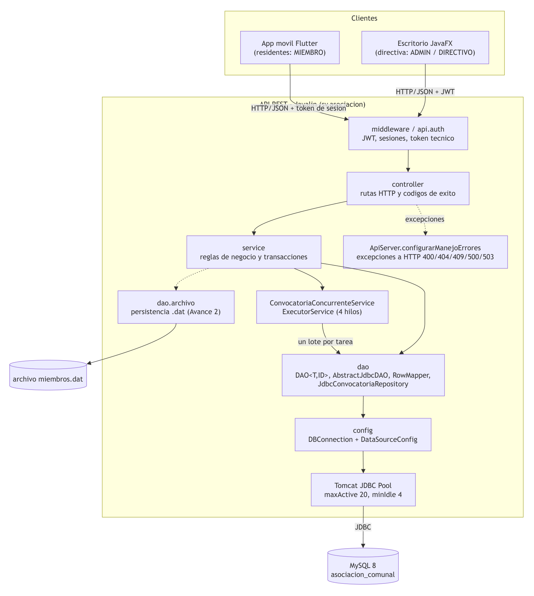
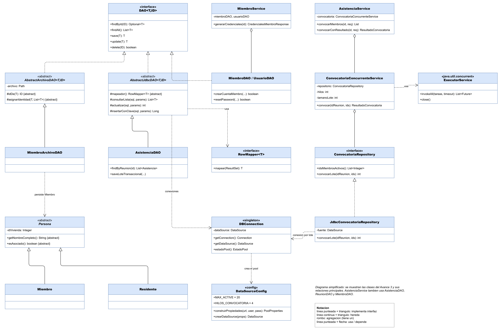
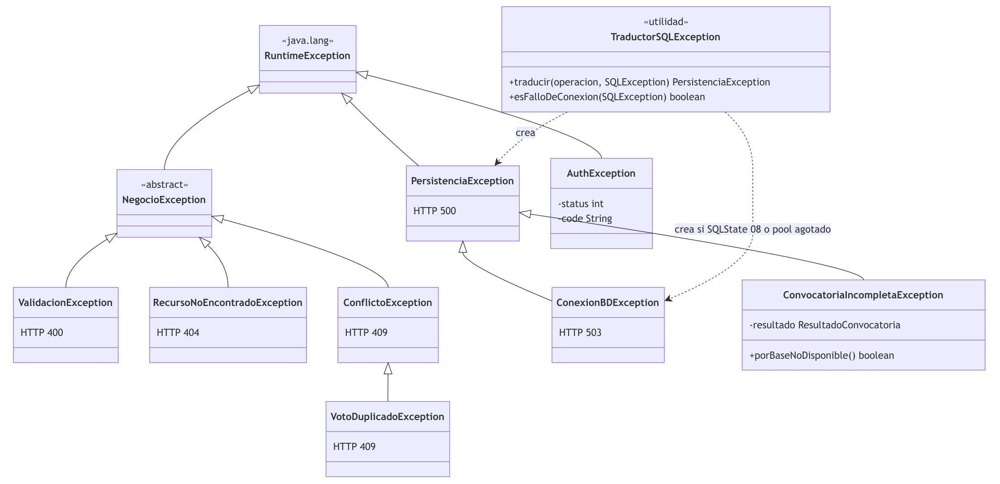

# Sistema para Administración de Asociación Comunal — Entrega final (Avance 3)

## 1. Portada

**Universidad Evangélica de El Salvador** · Facultad de Ingeniería
Ingeniería en Desarrollo de Software y Ciencia de Datos
**Programación II** — Entrega final del proyecto
Facilitador: **Ing. Daniel Enrique Guevara Gómez**
San Salvador, El Salvador · 2026

Repositorio público: <https://github.com/Miascn/AsociacionComunal>

| Fotografía | Nombre completo | CIF | ¿Participó? |
| --- | --- | --- | --- |
| *(insertar)* | Carlos Josué Samayoa Contreras | *(completar)* | *(SÍ/NO)* |
| *(insertar)* | Josué Jeremías Castillo Nieves | *(completar)* | *(SÍ/NO)* |
| *(insertar)* | Jonathan Alexis Amaya Hernández | *(completar)* | *(SÍ/NO)* |
| *(insertar)* | Génesis Michelle Flores Cruz | *(completar)* | *(SÍ/NO)* |
| *(insertar)* | David Rafael Coto Garza | *(completar)* | *(SÍ/NO)* |
| *(insertar)* | Rodrigo Gilberto Sánchez Ávalos | *(completar)* | *(SÍ/NO)* |
| *(insertar)* | Gerson Otoniel Bermúdez Ramírez | *(completar)* | *(SÍ/NO)* |
| *(insertar)* | Edgard Antonio Mendoza Vaquero | *(completar)* | *(SÍ/NO)* |

> Los CIF, las fotografías y la participación se completan en la copia que se entrega; no se publican en el repositorio.

---

## 2. Introducción

Las asociaciones comunales de El Salvador administran el padrón de sus asociados, recaudan una cuota mensual de mantenimiento, eligen a su junta directiva, convocan asambleas y votan los proyectos de mejora de la colonia. En la mayoría de los casos esa información vive en cuadernos y hojas de cálculo dispersas, sin control de acceso ni trazabilidad.

Este documento presenta la versión final del **Sistema para Administración de Asociación Comunal**, desarrollado durante el ciclo de Programación II como evolución de los dos avances anteriores:

- **Avance 1:** análisis del problema, historias de usuario, modelo de datos MySQL y estructura base del proyecto Java.
- **Avance 2:** encapsulamiento, herencia (`Persona` → `Miembro`/`Residente`), polimorfismo, clases abstractas, colecciones, arquitectura por capas, persistencia en archivos `.dat` y concurrencia en el cliente de escritorio.
- **Avance 3 (este documento):** persistencia JDBC con `DataSource` y pool de conexiones, programación concurrente integrada con la base de datos, jerarquía de excepciones propia, reducción del acoplamiento, reutilización del acceso JDBC y pruebas con JUnit y Mockito.

> **Observaciones de avances anteriores.** No se encontró retroalimentación escrita del facilitador sobre los avances 1 y 2 entre los materiales del equipo. Las correcciones de este documento responden a la revisión técnica interna del código y a los criterios de la guía de la entrega final.

---

## 3. Descripción del problema

La directiva de la asociación necesita:

- Mantener un **padrón** confiable de miembros y de las viviendas que habitan, sin perder el historial cuando un miembro deja de estar activo.
- Registrar la **cuota mensual** de mantenimiento y los aportes voluntarios a proyectos, y saber quién está al día.
- Gestionar la **junta directiva** por períodos y cargos.
- **Convocar asambleas** y llevar el control de asistencia.
- Someter **proyectos** a **votación** con un voto por miembro y resultados verificables.
- Dar a los residentes acceso a su información desde el **celular**.

Las restricciones del dominio (un voto por miembro, una cuota por período, un registro de asistencia por miembro y reunión) deben cumplirse aunque varias personas usen el sistema al mismo tiempo.

---

## 4. Objetivos

### Objetivo general

Desarrollar una aplicación Java respaldada por una base de datos MySQL que centralice y controle la información administrativa de una asociación comunal —censo de miembros, cargos de la directiva, aportaciones, proyectos, reuniones y votaciones— con validación, trazabilidad y control de acceso, aplicando programación orientada a objetos y una arquitectura por capas.

### Objetivos específicos

1. **(Avance 1)** Analizar y diseñar la arquitectura funcional y de datos del sistema mediante actores, historias de usuario, entidades y relaciones.
2. **(Avance 2)** Implementar el diseño con programación orientada a objetos —encapsulamiento, herencia, polimorfismo, clases abstractas y colecciones— en una arquitectura por capas con persistencia en archivos y concurrencia en la interfaz.
3. **(Avance 3)** Consolidar la persistencia relacional mediante JDBC con un `DataSource` y pool de conexiones, integrar un proceso concurrente con la base de datos, implementar un manejo de excepciones propio y verificar el comportamiento con pruebas unitarias JUnit y Mockito.

---

## 5. Requerimientos

### Requerimientos funcionales

| Código | Requerimiento | Implementación (API) |
| --- | --- | --- |
| RF-01 | Autenticar usuarios y aplicar permisos por rol | `/api/admin/auth/login` (JWT, escritorio), `/api/auth/*` (sesiones, móvil), `JwtAuthMiddleware` |
| RF-02 | Registrar, consultar, actualizar y desactivar miembros sin borrar su historial | `/api/miembros` (`MiembroController`, `MiembroService`) |
| RF-03 | Administrar cargos y períodos de directiva | `/api/cargos`, `/api/periodos`, `/api/asignaciones-cargo` |
| RF-04 | Registrar aportaciones y consultar el estado de la cuota | `/api/aportaciones`, `/api/aportaciones/mantenimiento` |
| RF-05 | Registrar proyectos comunitarios y controlar sus estados | `/api/proyectos` |
| RF-06 | Crear votaciones, opciones y períodos de participación | `/api/votaciones`, `/api/votaciones/{id}/opciones` |
| RF-07 | Validar un único voto por miembro en cada votación | `/api/votos` + restricción `uk_voto_votacion_miembro` |
| RF-08 | Gestionar reuniones y asistencia | `/api/reuniones`, `/api/reuniones/{id}/asistencias/*` (incluye la convocatoria concurrente) |
| RF-09 | Reportes administrativos | Resumen de cuota mensual (`/mantenimiento`) y tablero del escritorio; no hay exportación de reportes |
| RF-10 | Bitácora de acciones críticas | `/api/bitacoras` + registro automático de POST/PUT/PATCH/DELETE en `ApiServer` |

### Requerimientos no funcionales

| Código | Requerimiento | Cómo se cumple |
| --- | --- | --- |
| RNF-01 | Java y MySQL | Java 21+, MySQL 8, JDBC |
| RNF-02 | Sin contraseñas en texto plano | PBKDF2-HMAC-SHA256; la clave provisional se guarda cifrada (AES-256-GCM) |
| RNF-03 | Operaciones críticas transaccionales | Voto, lote de asistencias, convocatoria por lotes, alta de miembro con cuenta |
| RNF-04 | Mensajes claros | Errores de negocio con mensaje para el usuario; errores técnicos con mensaje genérico |
| RNF-05 | Integridad referencial | Llaves foráneas y restricciones únicas en `database/schema.sql` |
| RNF-07 | Organización por capas | Ver §6 |

Las historias de usuario HU-001 a HU-015 del Avance 1 siguen siendo la referencia funcional.

---

## 6. Arquitectura



El sistema tiene tres piezas:

- **API REST** (`api/`): Java 21 y Javalin. Contiene toda la lógica y el único acceso a la base de datos.
- **Cliente de escritorio** (`frontend/`): JavaFX, para la directiva (roles ADMIN y DIRECTIVO).
- **App móvil** (`flutter-app/`): Flutter, para los residentes (rol MIEMBRO). Es complementaria y no forma parte del alcance Java evaluado.

Ningún cliente accede a MySQL directamente.

| Paquete (`sv.asociacion`) | Responsabilidad |
| --- | --- |
| `controller` | Leer la petición HTTP, llamar al servicio y elegir el código de éxito |
| `service` | Reglas de negocio, validaciones, transacciones y el proceso concurrente |
| `dao` / `dao.archivo` | Acceso a datos: JDBC (MySQL) y archivos `.dat` |
| `domain.entity` / `domain.dto` | Entidades del dominio y objetos de entrada/salida (records) |
| `config` | `DataSourceConfig`, `DBConnection`, `AppConfig` |
| `exception` | Excepciones propias y traducción de `SQLException` |
| `util` | Fechas, hash y cifrado de credenciales, generador de claves provisionales |
| `middleware`, `api.auth` | Autenticación y autorización |

`ApiServer` es la **raíz de composición**: crea cada DAO y servicio una sola vez y los entrega por constructor. Ninguna clase de negocio crea sus propias dependencias.

---

## 7. Diagrama UML actualizado

Clases del Avance 3 y sus relaciones principales (fuente editable: `docs/avance3/uml.drawio`):



Jerarquía de excepciones (fuente: `docs/avance3/uml-excepciones.drawio`):



---

## 8. POO aplicada

### Encapsulamiento

Todas las entidades tienen atributos privados y exponen solo lo necesario. Ejemplos:

- `Miembro`: su estado es un `enum Estado { ACTIVO, INACTIVO }`, de modo que un estado inválido no puede existir.
- `DBConnection`: el pool es un campo privado `volatile`. Se crea dentro de la clase con verificación doble y nadie puede reemplazarlo desde fuera.
- `CifradorCredenciales`: la llave AES es un campo privado `final`; la clase solo ofrece `cifrar` y `descifrar`.
- `ResultadoConvocatoria`: es un record inmutable; su lista de pendientes se copia con `List.copyOf`.

### Herencia

| Clase base | Derivadas | Qué se especializa |
| --- | --- | --- |
| `Persona` (abstracta) | `Miembro`, `Residente` | Nombre completo y si la persona es asociada |
| `AbstractArchivoDAO<T,ID>` | `MiembroArchivoDAO` | Cómo se obtiene y asigna el identificador |
| `AbstractJdbcDAO<T,ID>` (nueva) | `AsistenciaDAO` | El `RowMapper` y el SQL de cada consulta |
| `NegocioException` (nueva) | `ValidacionException`, `RecursoNoEncontradoException`, `ConflictoException` | El significado y el código HTTP |
| `PersistenciaException` | `ConexionBDException`, `ConvocatoriaIncompletaException` | Base no disponible / convocatoria parcial |

### Polimorfismo

- `CensoMiembrosService` depende de `DAO<Miembro,Integer>`: el mismo servicio funciona con `MiembroDAO` (MySQL) o con `MiembroArchivoDAO` (`.dat`).
- `ConvocatoriaConcurrenteService` depende de `ConvocatoriaRepository`. En producción recibe `JdbcConvocatoriaRepository`; en las pruebas, un repositorio en memoria. El código del servicio es el mismo.
- `ApiServer.configurarManejoErrores` registra un manejador por tipo de excepción. Javalin elige el más específico según la clase real de la excepción lanzada: un `VotoDuplicadoException` se atiende como `ConflictoException` (409) y un `ConexionBDException` como base no disponible (503).

### Abstracción

- `Persona`, `AbstractArchivoDAO`, `AbstractJdbcDAO` y `NegocioException` son abstractas: definen lo común y dejan a cada subclase solo lo que le corresponde.
- `AbstractJdbcDAO` aplica el patrón **método plantilla**: el ciclo conexión → sentencia → parámetros → ejecución → lectura → cierre → traducción de errores se escribe una sola vez. Las subclases implementan `mapeador()` y `entidad()`.

### Interfaces

| Interfaz | Implementaciones | Para qué |
| --- | --- | --- |
| `DAO<T,ID>` | 14 DAO JDBC (directamente o mediante `AbstractJdbcDAO`) y `AbstractArchivoDAO` | Contrato CRUD genérico |
| `RowMapper<T>` (funcional) | Referencias a método, por ejemplo `AsistenciaDAO::mapear` | Convertir una fila en un objeto |
| `ConvocatoriaRepository` | `JdbcConvocatoriaRepository`, dobles de prueba | Desacoplar la concurrencia de JDBC |
| `UserAuthRepository`, `SessionRepository`, `TokenGenerator` | Implementaciones JDBC y seguras | Autenticación de la app móvil |

---

## 9. Colecciones y genéricos

**Genéricos:**

- Interfaces y clases genéricas: `DAO<T,ID>`, `AbstractJdbcDAO<T,ID>`, `AbstractArchivoDAO<T extends Serializable, ID>`, `RowMapper<T>`.
- Métodos genéricos: `<R> List<R> consultarLista(String sql, RowMapper<R> mapper, Object... parametros)` en `AbstractJdbcDAO`, que permite leer filas de otro tipo, por ejemplo `consultarEntero` con `rs -> rs.getInt(1)`; y `static <T> List<List<T>> particionar(List<T>, int)` en `ConvocatoriaConcurrenteService`.

**Colecciones con una razón de dominio:**

| Colección | Dónde | Por qué |
| --- | --- | --- |
| `List<T>` y `Optional<T>` | Contrato `DAO` | Resultados ordenados; "no encontrado" explícito sin `null` |
| `LinkedHashSet<Integer>` | `ConvocatoriaConcurrenteService.sinDuplicados` | Quita miembros repetidos conservando el orden solicitado |
| `List<List<Integer>>` | Lotes de la convocatoria | Cada sublista es una unidad de trabajo para un hilo |
| `List<Future<Integer>>` | Resultado de `invokeAll` | Un resultado por lote, en el mismo orden de los lotes |
| `HashSet<Integer>` | `AsistenciaService.registrarLote` | Detecta un miembro repetido en el lote en O(1) |
| `Map<Integer, AportacionDetail>` | `AportacionService.getMantenimientoPeriodo` | Busca el pago de cada miembro por id sin recorrer la lista |
| `ConcurrentHashMap.newKeySet()` | Pruebas de concurrencia | Conjunto seguro entre hilos que reproduce la restricción única |

El inventario completo del Avance 2 sigue en `docs/avance2/colecciones.md`.

---

## 10. Programación concurrente

**Qué proceso se ejecuta concurrentemente.** La **convocatoria masiva a una asamblea**: crear un registro de asistencia pendiente para cada miembro activo, o para los miembros indicados, de una reunión. Clases: `service/ConvocatoriaConcurrenteService` y `dao/JdbcConvocatoriaRepository`. Endpoints: `POST /api/reuniones/{id}/asistencias/convocar` (devuelve la lista de asistencia) y `POST /api/reuniones/{id}/asistencias/convocatoria` (devuelve el resultado del proceso).

**Por qué se usa concurrencia.** Antes, la convocatoria hacía en serie, por cada miembro, una consulta de existencia, otra de estado y una inserción: con cientos de miembros eran cientos de viajes a MySQL en el hilo de la petición. Ahora los miembros se dividen en lotes de 25 que varios hilos escriben a la vez. El tiempo total depende del lote más lento y no de la suma de todos.

**Qué mecanismo se utilizó.**

- `ExecutorService` de tamaño fijo, creado con `Executors.newFixedThreadPool`, con hilos con nombre (`convocatoria-reunion-<id>-<n>`) y daemon.
- `invokeAll(tareas, 60 s)`: ejecuta todos los lotes y cancela los que excedan el tiempo máximo.
- Cada lote es un `Callable<Integer>` que devuelve cuántos registros creó. Los resultados se leen con `Future.get()` y los fallos llegan como `ExecutionException`. No hay contadores compartidos que sincronizar.
- El executor se cierra con try-with-resources: en Java 21, `ExecutorService.close()` espera a que terminen las tareas.
- Si el hilo se interrumpe, se restaura su estado de interrupción.

**Cómo interactúa con la base de datos.** `JdbcConvocatoriaRepository` recibe el `DataSource` con pool. Cada tarea:

1. pide **su propia conexión** al pool;
2. desactiva `autoCommit`;
3. ejecuta un **batch** de `PreparedStatement`:
   ```sql
   INSERT IGNORE INTO asistencia (id_reunion, id_miembro, asistio, observacion)
   SELECT ?, m.id_miembro, FALSE, NULL FROM miembro m WHERE m.id_miembro = ? AND m.estado = 'ACTIVO'
   ```
4. confirma con `commit` (o `rollback` si falla), restaura `autoCommit` y devuelve la conexión al pool al cerrar el try-with-resources.

**Cómo se controlan los problemas de concurrencia.**

| Problema | Control |
| --- | --- |
| Dos hilos o dos coordinadores convocan al mismo miembro | La restricción única `uk_asistencia_reunion_miembro` decide en la base. `INSERT IGNORE` convierte el duplicado en "0 filas afectadas": la operación es idempotente. No se usa `synchronized`, que no protegería frente a otra instancia de la API ni frente al escritorio. |
| Conexiones compartidas entre hilos | Cada tarea usa su propia `Connection`; JDBC no garantiza que una conexión sea segura para varios hilos |
| Agotar el pool | 4 hilos (`HILOS_CONVOCATORIA`) frente a `maxActive = 20`: siempre quedan conexiones para las demás peticiones |
| Miembro desactivado durante la convocatoria | El filtro `estado = 'ACTIVO'` está en la misma sentencia de inserción |
| Fallo de un lote | Cada lote es una transacción. Los demás quedan confirmados y se lanza `ConvocatoriaIncompletaException` con los miembros pendientes (HTTP 503 si la base no estaba disponible, 500 en otro caso). Repetir la convocatoria completa solo a los pendientes. |
| Lote que no termina | `invokeAll` con tiempo máximo cancela la tarea, que queda registrada como pendiente |

**Evidencia en las pruebas** (`ConvocatoriaConcurrenteServiceTest`, `JdbcConvocatoriaRepositoryTest`):

- Las tareas corren en los hilos del executor y se solapan: cuatro lotes están en curso al mismo tiempo, comprobado con un `CountDownLatch`.
- Nunca hay más tareas simultáneas que hilos.
- Dos convocatorias simultáneas de la misma reunión crean cada registro exactamente una vez.
- Un lote fallido, la base caída y un lote lento producen el resultado parcial correcto.
- Con un `DataSource` simulado por Mockito, 8 lotes usan 8 conexiones distintas, y cada una se confirma y se cierra.

---

## 11. JDBC

**Conexión.** `DBConnection.getConnection()` entrega una conexión del pool. Los parámetros (servidor, base, usuario y contraseña) se leen de variables de entorno, de `.env` o de `database-local.properties`; nunca están en el código.

**DataSource y pool.** `DataSourceConfig` crea un `org.apache.tomcat.jdbc.pool.DataSource` (§12). Como `close()` devuelve la conexión al pool en lugar de cerrar el socket, los DAO existentes conservaron su `try (Connection c = DBConnection.getInstance().getConnection())` sin cambios.

**DAO/Repository.** Cada tabla tiene su DAO, que implementa `DAO<T,ID>`. Las clases nuevas del Avance 3 (`AbstractJdbcDAO`, `AsistenciaDAO`, `JdbcConvocatoriaRepository`) también aceptan un `DataSource` por constructor, lo que permite probarlas sin MySQL.

**PreparedStatement.** Toda consulta con datos usa parámetros `?`; nunca se concatena un valor en el SQL. Ejemplo en `AbstractJdbcDAO`:

```java
try (Connection conn = conexion();
     PreparedStatement ps = preparar(conn, sql, parametros);   // ps.setObject(i + 1, parametros[i])
     ResultSet rs = ps.executeQuery()) {
    List<R> resultado = new ArrayList<>();
    while (rs.next()) {
        resultado.add(mapper.mapear(rs));
    }
    return resultado;
} catch (SQLException e) {
    throw TraductorSQLException.traducir("consultar datos de " + entidad(), e);
}
```

**ResultSet.** Se recorre con `rs.next()` y se convierte con un `RowMapper`, por ejemplo `AsistenciaDAO.mapear` con `rs.getLong("id_asistencia")`, `rs.getBoolean("asistio")`, etc. Siempre se cierra en el try-with-resources.

**executeQuery / executeUpdate / batch.**

- `executeQuery()` para consultas (`consultarLista`, `consultarEntero`, `existe`).
- `executeUpdate()` para INSERT/UPDATE/DELETE (`actualizar`, `insertarConClave` con `RETURN_GENERATED_KEYS`).
- `executeBatch()` para la convocatoria y el lote de asistencias.

**CRUD.** Ejemplo completo en `AsistenciaDAO`:

| Operación | Método |
| --- | --- |
| Crear | `save` (`insertarConClave`) |
| Leer | `findById`, `findAll`, `findByReunion`, `findByMiembro` |
| Actualizar | `update`, `toggleAsistencia` |
| Eliminar | `delete`, `deleteByReunion` |

**Transacciones.** El voto (`VotoDAO.registrarUnico`), el lote de asistencias, la convocatoria por lotes, el cambio de estado de un miembro y el alta de miembro con su cuenta usan `setAutoCommit(false)`, `commit` y `rollback`.

---

## 12. Configuración del DataSource

Clase: `api/src/main/java/sv/asociacion/config/DataSourceConfig.java`. Implementación: Tomcat JDBC Pool 11.0.27. Se eligió porque sus parámetros coinciden con los que pide la guía, incluidos `testOnConnect` y `validationInterval`, que no existen en otros pools.

**Contexto para los valores:**

- Una sola asociación: pocos administradores en el escritorio y los residentes desde el celular.
- Consultas cortas.
- Un único proceso que pide varias conexiones a la vez: la convocatoria concurrente, con 4 hilos.
- MySQL admite 151 conexiones por defecto.

| Parámetro | Valor | Propósito y justificación |
| --- | ---: | --- |
| `validationQuery` | `SELECT 1` | Consulta mínima que obliga a MySQL a responder |
| `initialSize` | 4 | Conexiones abiertas al crear el pool; cubren el uso típico sin esperar el primer handshake |
| `minIdle` | 4 | Mínimo de conexiones inactivas que se conservan; igual a `initialSize` para que el pool no oscile |
| `maxIdle` | 8 | Máximo de inactivas; el excedente tras una ráfaga se cierra |
| `maxActive` | 20 | Máximo de conexiones prestadas a la vez: los 4 hilos de la convocatoria más las peticiones HTTP simultáneas, con margen frente a las 151 de MySQL |
| `maxWait` | 10000 ms | Tiempo máximo de espera de una conexión; después se lanza `PoolExhaustedException` y el cliente recibe 503 en lugar de quedar colgado |
| `testOnBorrow` | `true` | Valida al prestar: el cliente nunca recibe una conexión que MySQL cerró por `wait_timeout` |
| `testOnReturn` | `false` | Validar al devolver duplicaría el costo; ya se valida al prestar |
| `testWhileIdle` | `true` | El evictor descarta conexiones inactivas rotas antes de prestarlas |
| `testOnConnect` | `true` | Valida cada conexión física al crearla: un error de credenciales o de red aparece de inmediato |
| `validationInterval` | 30000 ms | Intervalo mínimo entre validaciones de la misma conexión; evita ejecutar `SELECT 1` en cada préstamo |
| `timeBetweenEvictionRunsMillis` | 30000 ms | Cada cuánto el evictor revisa inactivas, excedentes y abandonadas |
| `minEvictableIdleTimeMillis` | 60000 ms | Inactividad tras la cual una conexión puede cerrarse (respetando `minIdle`); muy por debajo de las 8 h de `wait_timeout` |
| `removeAbandoned` | `true` | Recupera conexiones que el código tomó y nunca cerró |
| `removeAbandonedTimeout` | 60 s | Las operaciones duran milisegundos; 60 s solo los supera una fuga real |

**Configuración adicional:**

- **Interceptor `ConnectionState`:** restablece `autoCommit` en cada préstamo. Con un pool, una conexión que un DAO transaccional dejó con `autoCommit=false` llegaría así al siguiente usuario. Al migrar se encontró que `VotoDAO.registrarUnico` no lo restauraba; se corrigió en el DAO y el interceptor lo garantiza para cualquier otro caso.
- **Interceptor `StatementFinalizer`:** cierra sentencias olvidadas.
- **`rollbackOnReturn` no se usa:** se comprobó en el bytecode de Tomcat que solo se aplica cuando `defaultAutoCommit=false`, y el sistema usa `autoCommit=true` por defecto.

**Demostración de que el pool funciona** (`DataSourceConfigTest`, con una fuente JDBC falsa y sin MySQL):

- 10 préstamos seguidos reutilizan las 4 conexiones físicas iniciales; ninguna se cierra al llamar a `close()`.
- Con `maxActive=2`, el tercer préstamo espera aproximadamente `maxWait` y falla con `SQLException`.
- El siguiente usuario de una conexión recibe `autoCommit=true` aunque el anterior lo haya desactivado.

Además, `/health` informa las conexiones activas, inactivas y el máximo del pool en ejecución.

---

## 13. Cohesión y acoplamiento

**Una clase con buena cohesión: `ConvocatoriaConcurrenteService`.** Todo lo que contiene sirve a una sola responsabilidad: repartir la convocatoria en lotes, ejecutarlos en paralelo y agregar el resultado.

- No conoce SQL ni HTTP.
- No valida reglas de la reunión: eso es de `AsistenciaService`.
- No sabe de dónde salen las conexiones: eso es del repositorio.

**Una dependencia que se redujo: `MiembroService` → base de datos.** Antes, `MiembroService.generarCredenciales` abría una conexión con `DBConnection`, contenía tres sentencias `INSERT` y usaba la `SQLException` como control de flujo. Además, su constructor creaba un `new UsuarioDAO()` por su cuenta.

Ahora:

- el SQL vive en `UsuarioDAO.crearCuentaMiembro`;
- el servicio recibe `UsuarioDAO` por constructor desde `ApiServer`;
- ya no importa `java.sql` ni `DBConnection`.

**Una decisión de diseño que disminuye el acoplamiento: depender de interfaces e inyectar por constructor.**

- `ConvocatoriaConcurrenteService` depende de la interfaz `ConvocatoriaRepository`, no de `JdbcConvocatoriaRepository`. Gracias a eso, la lógica de hilos se prueba con un repositorio en memoria y podría cambiar de almacenamiento sin tocar el servicio.
- `JdbcConvocatoriaRepository` y `AbstractJdbcDAO` reciben un `javax.sql.DataSource` (interfaz estándar), no la clase de Tomcat.
- `HealthController` recibe funciones (`BooleanSupplier`, `Supplier<EstadoPool>`) en lugar de abrir una `Connection`.

**Otras mejoras:**

- Se eliminó `DAOFactory`, que no se usaba.
- El generador de claves provisionales, que estaba copiado en cuatro clases, se concentró en `GeneradorClaveTemporal`.

**Pendiente reconocido:** la mayoría de los servicios aún dependen de clases DAO concretas. Se aplicó la inversión de dependencias en el camino del Avance 3 y no en todo el proyecto, para no arriesgar funcionalidades estables.

---

## 14. Legibilidad y reutilización

Se revisaron nombres, responsabilidades, duplicación, tamaño de métodos y organización de paquetes en las clases del Avance 3.

### Antes / después 1 — controladores sin `try/catch` repetidos

**Antes** (`MiembroController`, rama `develop`): cada método repetía la traducción de excepciones; había 94 bloques similares en 16 controladores.

```java
public void create(Context context) {
    CreateMemberRequest request = context.bodyAsClass(CreateMemberRequest.class);
    try {
        var response = miembroService.createMember(request);
        context.status(HttpStatus.CREATED).json(response);
    } catch (IllegalArgumentException e) {
        context.status(HttpStatus.BAD_REQUEST).json(Map.of("error", e.getMessage()));
    } catch (IllegalStateException e) {
        context.status(HttpStatus.CONFLICT).json(Map.of("error", e.getMessage()));
    }
}

public void generarCredenciales(Context context) {
    int id = context.pathParamAsClass("id", Integer.class).get();
    try {
        var cred = miembroService.generarCredenciales(id);
        if (cred == null) {
            context.status(HttpStatus.NOT_FOUND).json(Map.of("error", "Miembro no encontrado."));
        } else {
            context.status(HttpStatus.CREATED).json(cred);
        }
    } catch (Exception e) {
        context.status(HttpStatus.INTERNAL_SERVER_ERROR).json(Map.of("error", e.getMessage()));
    }
}
```

**Después:** el controlador solo hace lo suyo; la traducción vive una vez en `ApiServer.configurarManejoErrores`.

```java
public void create(Context context) {
    CreateMemberRequest request = context.bodyAsClass(CreateMemberRequest.class);
    context.status(HttpStatus.CREATED).json(miembroService.createMember(request));
}

public void generarCredenciales(Context context) {
    responderOEncontrado(context, miembroService.generarCredenciales(id(context)), HttpStatus.CREATED);
}
```

Esto corrigió además dos defectos:

- el `catch (Exception)` devolvía `e.getMessage()`, que podía contener texto de MySQL;
- un fallo de base de datos en `MiembroDAO.save` se envolvía en `IllegalStateException` y se respondía como **409 Conflicto**.

### Antes / después 2 — reutilización del acceso JDBC

**Antes** (`AsistenciaDAO.findByReunion`): 16 líneas de ciclo JDBC repetidas en cada método de cada DAO, con la `SQLException` impresa y silenciada.

```java
public List<Asistencia> findByReunion(Integer idReunion) {
    List<Asistencia> list = new ArrayList<>();
    String sql = "SELECT * FROM asistencia WHERE id_reunion = ?";
    try (Connection conn = DBConnection.getInstance().getConnection();
         PreparedStatement ps = conn.prepareStatement(sql)) {
        ps.setInt(1, idReunion);
        try (ResultSet rs = ps.executeQuery()) {
            while (rs.next()) {
                list.add(mapResultSet(rs));
            }
        }
    } catch (SQLException e) {
        e.printStackTrace();
    }
    return list;
}
```

**Después:** el DAO declara solo su SQL; `AbstractJdbcDAO` y `RowMapper` hacen el resto.

```java
public List<Asistencia> findByReunion(Integer idReunion) {
    return consultarLista(SELECT + " WHERE id_reunion = ?", idReunion);
}
```

`AsistenciaDAO` pasó de 250 a unas 150 líneas con la misma API pública.

---

## 15. Manejo de excepciones

**Jerarquía propia** (paquete `exception`, ver §7):

| Excepción | Significado | HTTP |
| --- | --- | --- |
| `NegocioException` (abstracta) | Base de los errores de negocio | — |
| `ValidacionException` | Datos inválidos | 400 |
| `RecursoNoEncontradoException` | El recurso no existe | 404 |
| `ConflictoException` / `VotoDuplicadoException` | Choca con el estado actual / segundo voto | 409 |
| `PersistenciaException` | Fallo al leer o escribir en la base | 500 |
| `ConexionBDException` | Base no disponible o pool agotado | 503 |
| `ConvocatoriaIncompletaException` | Uno o más lotes de la convocatoria fallaron | 503 / 500 |
| `AuthException` | Autenticación o autorización | Su propio estado (401/403) |

**Errores JDBC.** Antes, 123 bloques `catch (SQLException e) { e.printStackTrace(); }` en 15 DAO devolvían una lista vacía, `false` o `null`: una caída de la base se veía como "no hay datos". Ahora todos lanzan la excepción traducida por `TraductorSQLException`:

```java
} catch (SQLException e) {
    throw TraductorSQLException.traducir("consultar las reuniones", e);
}
```

`TraductorSQLException.esFalloDeConexion` reconoce la base caída de cuatro formas, incluso si la causa viene anidada:

- `PoolExhaustedException`;
- `SQLTransientConnectionException`;
- `SQLNonTransientConnectionException`;
- un SQLState `08xxx`.

El mensaje de la excepción es un texto seguro; la `SQLException` original se conserva como causa para el registro del servidor.

**Errores de negocio.** Los servicios nuevos o modificados lanzan excepciones propias, por ejemplo `ValidacionException` ante un id inválido en la convocatoria. Los servicios anteriores al Avance 3 siguen usando `IllegalArgumentException` (400) e `IllegalStateException` (409). El manejador central conserva ese significado para no cambiar el comportamiento de funciones estables.

**Uso de try / catch / finally / throw / throws:**

- `try-with-resources` en todo acceso JDBC.
- `finally` en las transacciones para restaurar `autoCommit`.
- `throw` de excepciones propias.
- `throws SQLException` en `AsistenciaDAO.saveLoteTransaccional`, cuyo llamador decide la traducción.
- Las excepciones se capturan solo donde hay algo que hacer con ellas: deshacer la transacción, traducirlas o agregarlas por lote.

**Traducción a HTTP centralizada** en `ApiServer.configurarManejoErrores`. Los errores técnicos se registran en el servidor con su SQLState y código; el cliente recibe solo un mensaje genérico.

---

## 16. Pruebas unitarias

**Herramientas:**

- JUnit 5.14.2 con `assertEquals`, `assertTrue`, `assertFalse`, `assertNull`, `assertThrows`, `assertInstanceOf`, `assertSame`.
- Mockito 5.24.0 (`@Mock`, `when`, `verify`, `never`, `times`, `ArgumentCaptor`, `@ExtendWith(MockitoExtension.class)`), cargado como agente en Surefire.

**Pruebas agregadas en el Avance 3:**

| Clase de prueba | Qué verifica | Tipo |
| --- | --- | --- |
| `DataSourceConfigTest` | Parámetros del pool, reutilización de conexiones, `maxActive`/`maxWait`, `autoCommit` | Configuración |
| `TraductorSQLExceptionTest` | Base caída vs. error de la operación; el mensaje no filtra SQL; jerarquía | Utilidad / error |
| `ManejoErroresRoutesTest` | 400/404/409/500/503 sobre Javalin real; sin SQL en la respuesta | Controlador |
| `AsistenciaDaoJdbcTest` | `AbstractJdbcDAO`: parámetros, mapeo, clave generada, cierre de recursos, transacción | DAO + Mockito |
| `ConvocatoriaConcurrenteServiceTest` | Hilos, solapamiento, límite de hilos, idempotencia, convocatorias simultáneas, fallos, tiempo máximo | Servicio / concurrencia |
| `JdbcConvocatoriaRepositoryTest` | SQL idempotente, batch, commit/rollback, una conexión por tarea | Repositorio + Mockito |
| `MiembroServiceTest` | Validación, conflicto, credenciales, falta de roles, fallo de dependencia | Servicio + Mockito |
| `AsistenciaServiceConvocatoriaTest` | Reglas de la reunión antes de convocar; propagación del fallo | Servicio + Mockito |
| `ConvocatoriaRoutesTest` | 201, lista explícita, 403, 409, 503 | Controlador + Mockito |
| `HealthControllerTest` | 200/503 y estado del pool | Controlador |
| `DateUtilsTest`, `PasswordHasherTest`, `GeneradorClaveTemporalTest`, `CifradorCredencialesTest` | Casos válidos, nulos e inválidos | Utilidades |
| `QaApiConfigTest` (escritorio) | HTTP solo hacia localhost; HTTPS obligatorio fuera | Validación |

Cada clase cubre casos exitosos, casos de error y reglas de negocio. Ninguna prueba se limita a ejecutar un método sin verificar el resultado.

**Ejemplo con Mockito:**

```java
@Test
void restableceCuentaExistente() {
    when(miembroDAO.findById(5)).thenReturn(Optional.of(miembro(5, "01234567-8")));
    when(usuarioDAO.findByIdMiembro(5)).thenReturn(Optional.of(existente));

    var cred = service.generarCredenciales(5);

    ArgumentCaptor<String> hash = ArgumentCaptor.forClass(String.class);
    verify(usuarioDAO).resetPassword(eq(40), hash.capture(), eq(true), eq(cred.claveTemporal()));
    assertTrue(PasswordHasher.verify(cred.claveTemporal(), hash.getValue()));
    verify(usuarioDAO, never()).crearCuentaMiembro(anyInt(), any(), any(), any());
}
```

**Evidencia de ejecución** (`./mvnw clean test`, ver capturas en el anexo):

| Módulo | Pruebas | Fallos | Errores | Omitidas |
| --- | ---: | ---: | ---: | ---: |
| API (`api`) | 385 | 0 | 0 | 0 |
| Escritorio (`frontend`) | 70 | 0 | 0* | 0 |

\* Dos pruebas de navegación FXML requieren una configuración de API sintácticamente válida (`QA_API_URL` y `QA_API_TOKEN`). Sin ella fallan por entorno; con ella, el módulo pasa 70/70. Ninguna prueba requiere MySQL.

---

## 17. Git / GitHub

- **Repositorio público:** <https://github.com/Miascn/AsociacionComunal>, rama de integración `develop`.
- **Estrategia de ramas** (`docs/FLUJO_GIT.md`): `develop` es la fuente de verdad. Cada cambio se hace en una rama propia (`feat|fix|docs/SCRUM-###-descripcion`) y se integra por Pull Request. `main` recibe versiones estables. El Avance 3 se desarrolló en la rama aislada `feature/avance3-implementation`, creada desde `develop` (`34bd8df`, entrega del Avance 2), con un commit por bloque de la rúbrica. No usa la clave de ticket porque el trabajo se planificó por bloques de la guía.
- **Evolución:**
  - Avance 1 (julio): estructura inicial, DAO y modelo.
  - Avance 2 (agosto–septiembre): módulos funcionales, `.dat`, jerarquía `Persona`, cambios integrados mediante Pull Requests hasta el #39.
  - Avance 3 (octubre): los commits siguientes.

| Commit | Mensaje |
| --- | --- |
| `f96b6fb` | feat(api): implementa DataSource y pool de conexiones con Tomcat JDBC |
| `ab913e5` | refactor(api): centraliza manejo de excepciones y elimina SQLException silenciadas |
| `e5921de` | fix(api): elimina returns inalcanzables tras traducir SQLException |
| `dc4acd6` | refactor(api): mejora cohesion y reduce acoplamiento en miembros y credenciales |
| `48b0327` | refactor(api): mejora reutilizacion de acceso JDBC con AbstractJdbcDAO y RowMapper |
| `d31d0f0` | feat(api): agrega convocatoria concurrente a reuniones integrada con la base de datos |
| `944ba7b` | test(api): agrega pruebas Avance 3 con JUnit y Mockito |
| `0b833cb` | fix(api): protege credenciales temporales de usuario con cifrado en reposo |
| `950667c` | chore: actualiza scripts y artefactos de base de datos para la entrega final |
| `4fd5ac5` | docs: actualiza README para la entrega final |
| *(merge)* | docs: incorpora la estrategia de ramas (FLUJO_GIT.md) desde docs/flujo-git-actualizado |

- **Participación:** el historial de `develop` registra commits de las cuentas `MiasCN` (Josué Castillo), `SamayoaGit` / Carlos Samayoa y `G3rze` (Gerson Bermúdez). La participación de cada integrante en esta entrega se declara en la portada.

---

## 18. Conclusiones

1. Con el **pool de conexiones**, la aplicación reutiliza un conjunto acotado de conexiones físicas en lugar de abrir una por consulta. Conservar la firma de `DBConnection.getConnection()` permitió migrar todos los DAO sin reescribirlos. La migración también obligó a cuidar el estado de las conexiones reutilizadas (`autoCommit`), un problema que no existía con `DriverManager`.
2. La **concurrencia** tiene sentido cuando responde a un proceso real del dominio. En la convocatoria a asambleas, los hilos aceleran la escritura, pero la corrección la garantiza la base de datos (restricción única e inserción idempotente), no la sincronización en memoria.
3. Un **manejo de excepciones explícito** cambia lo que el usuario ve: antes, una caída de la base se mostraba como una lista vacía o como un conflicto 409; ahora se distingue un error de negocio (4xx) de un fallo técnico (500) y de una base no disponible (503), sin exponer detalles internos.
4. **Depender de interfaces** (`ConvocatoriaRepository`, `DataSource`, `DAO<T,ID>`) y recibir las dependencias por constructor hizo posible probar la lógica concurrente y los DAO sin MySQL, con JUnit y Mockito.
5. Las abstracciones genéricas (`AbstractJdbcDAO<T,ID>`, `RowMapper<T>`) eliminan código repetido y concentran en un solo lugar el manejo correcto de recursos y errores, de modo que el próximo DAO hereda ese comportamiento sin volver a escribirlo.

---

### Anexo — cómo ejecutar y verificar

Ver `README.md`:

- `scripts/run.sh db` — MySQL con `database/schema.sql` y `database/data.sql`;
- `scripts/run.sh api` — la API;
- `scripts/run.sh desktop` — el escritorio;
- `scripts/run.sh test` — las pruebas.

Usuarios de prueba: `demo.admin`, `demo.directiva`, `demo.miembro` (contraseñas en el README; solo para la base de demostración).
